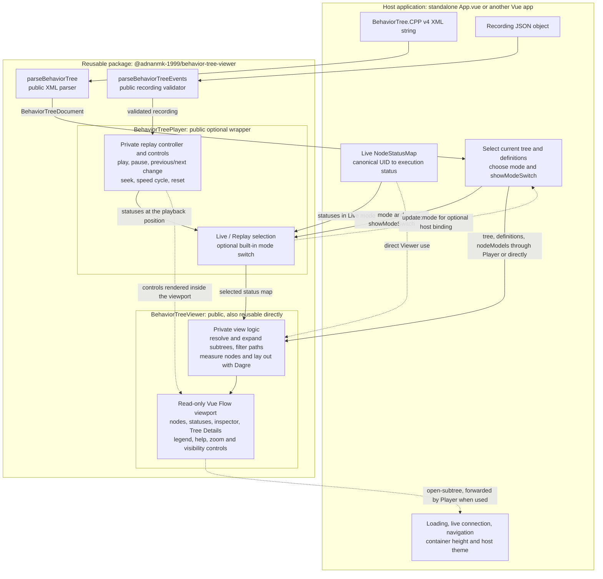

# Behavior Tree Visualizer

A Vue 3 viewer for BehaviorTree.CPP trees and execution statuses. This repository
contains the reusable viewer library and a standalone playground for inspecting
trees, navigating subtrees, and replaying recorded status changes.

## Run locally

Use Node.js 24.12 or newer, or a compatible version listed in `package.json`.

```sh
npm ci
npm run dev
```

Open the URL printed by Vite. The playground loads `public/tree.xml` and
`public/data/behavior-tree-events.json`. If the recording is missing or invalid,
the tree remains available for navigation and inspection.

## Development and releases

| Branch    | Purpose                                                       |
| --------- | ------------------------------------------------------------- |
| `develop` | Ongoing development, documentation, and verification          |
| `main`    | Release-ready code used to build and publish package versions |

Work on `develop`, including release metadata and version updates. When the
changes are ready, merge them into `main` through a pull request. Build and publish
from a clean `main` checkout, tagging the released commit with `vX.Y.Z`.

Applications install a package version; they do not depend on a Git branch.
Merging into `main` does not automatically publish a package. Agent instructions
for this workflow are in [AGENTS.md](AGENTS.md).

## Library package

The package is `@adnanmk-1999/behavior-tree-viewer`, currently version `0.1.0`.
Its publish destination is GitHub Packages at `https://npm.pkg.github.com`.
An npmjs.com account is not needed for this registry.

`src/App.vue` owns the playground's loading and navigation. It uses local
`BehaviorTreePlayer` source during development. The player wraps
`BehaviorTreeViewer` with replay timing, transport controls, and an optional
Live/Replay switch. The playground enables this package-owned switch; it supplies
no viewport markup or control styles.
`src/index.ts` defines the library's public exports: both components,
`parseBehaviorTree`, `parseBehaviorTreeEvents`, and the tree/status/recording
TypeScript types. The package also exports `style.css`.

```sh
npm run build:lib    # library JavaScript, CSS, and declarations in dist-library/
npm run test:package # pack, install in a temporary consumer, check types, and build
npm pack             # rebuild and create adnanmk-1999-behavior-tree-viewer-0.1.0.tgz
```

Vue 3.5+ is supplied by the consuming application. Vue Flow and Dagre remain
implementation dependencies. The archive includes the compiled library, its public
declarations, icon license, README, and package metadata. Demo XML, recordings,
application code, and development tools stay in this repository.

The existing `npm run build` builds the standalone app into `dist/`. Packing and
testing work locally before a version is published.

### Architecture and reusable parts

The host supplies tree data and execution data. The package owns rendering and,
when using `BehaviorTreePlayer`, playback and its controls. Solid arrows show
data flow; dotted arrows show events, optional direct use, or UI composition.



Both components consume the same tree representation. The Player wraps the
Viewer and selects its status source; it does not duplicate the rendering code.
The package also exports its tree/status/recording TypeScript types and
`style.css`. Consumers import the stylesheet once and supply Vue as a peer
dependency. Vue Flow and Dagre are implementation dependencies.

| Component input | Used by | Required/default | Purpose |
| --- | --- | --- | --- |
| `tree` | Viewer and Player | Required | Current `BehaviorTreeDefinition` to display. |
| `definitions` | Viewer and Player | Required | All definitions, used to resolve subtree instances. |
| `nodeModels` | Viewer and Player | Optional | Registered node categories such as Action or Control. |
| `statuses` | Viewer and Player | Empty map | Current `NodeStatusMap`; the Player uses it in Live mode. |
| `recording` | Player | `null` | Validated `BehaviorTreeRecording`, used in Replay mode. |
| `mode` / `v-model:mode` | Player | Required | Explicitly select `'live'` or `'replay'`; binding allows the host to observe/control selection. |
| `showModeSwitch` | Player | `false` | Enable the package-owned Live/Replay buttons. |

`statuses` maps decimal-string UIDs to `IDLE`, `RUNNING`, `SUCCESS`, `FAILURE`, or
`SKIPPED`, for example `new Map([['44', 'RUNNING']])`. Missing entries display as
Not observed. A recording contains ordered, timestamped UID status transitions
and metadata; it is not a status snapshot or a raw MCAP file. Already prepared
tree objects and validated recordings can be supplied directly, without calling
the parser helpers again.

- Reuse **Viewer** when the host already controls status updates or playback timing.
- Reuse **Player** for a fixed Live mode, a fixed Replay mode, or both with the
  optional switch and built-in playback controls.
- Reuse either **parser independently** when another feature needs parsed tree
  definitions or validated recording data.
- Keep file/network loading, robot connections, breadcrumbs, selection of the
  current tree, and the parent container's size in the **host application**.

`open-subtree` supplies a reference node so the host can choose the next tree;
the Player forwards this event from its Viewer. Inline subtree expansion stays
inside the package. Live mode pauses replay, and returning to Replay preserves
its position. Changing the current tree also preserves playback; replacing the
recording resets it.

The public export boundary is [src/index.ts](src/index.ts). Playback/view
composables, layout utilities, icons, and child components are private
implementation details, even though they are shared within this repository.
The demo imports local Player source; its page shell, fixtures, and
`scripts/export_bt_events.py` remain outside the package. App builds go to
`dist/`; library JavaScript, CSS, and declarations go to `dist-library/`.

## Publish to GitHub Packages

Publishing is manual. GitHub initially creates the package with private
visibility; visibility is managed in its package settings. The manifest's
`publishConfig.registry` selects GitHub Packages, and `repository` links the
package to this source repository. The npm `private: true` flag is absent because
it would block publishing entirely. See [GitHub's npm registry guide](https://docs.github.com/en/packages/working-with-a-github-packages-registry/working-with-the-npm-registry).

### Authenticate

Create a **personal access token (classic)** in [GitHub token settings](https://github.com/settings/tokens)
with `write:packages` and `read:packages` for publishing. Consumers only need
`read:packages` and access to the package. See [GitHub package permissions](https://docs.github.com/en/packages/learn-github-packages/about-permissions-for-github-packages).

Run this once on each machine that needs package access:

```sh
npm login --scope=@adnanmk-1999 --auth-type=legacy --registry=https://npm.pkg.github.com
```

Enter your GitHub username and use the token as the password. Keep credentials in
your user-level npm configuration, outside this repository. The GitHub CLI login
used for `git push` is separate from package authentication.

### Release

Prepare version changes on `develop`, keeping `package.json` and
`package-lock.json` in sync. For later patch releases, use
`npm version patch --no-git-tag-version`; the release tag belongs on `main`.
Commit and push the changes, then merge a pull request from `develop` into `main`.

From a clean working tree, switch to the merged release and verify it:

```sh
git switch main
git pull --ff-only origin main
npm ci
npm test
npm run build
npm run lint
npm run test:package
npm publish --dry-run
git status --short
```

Confirm the dry run targets `https://npm.pkg.github.com`, contains the expected
library files and license, and that the working tree is still clean. A dry run
does not upload a package or prove that your account has publish access.

For the first release, publish:

```sh
npm publish
```

After publishing succeeds, tag the source commit:

```sh
git tag -a v0.1.0 -m "Release 0.1.0"
git push origin v0.1.0
```

For later releases, use the version from `package.json` in both the tag and the
installation command.
Verify the published version by installing it in another application as below.

A later move to npmjs.com requires an npm account with access to the chosen scope,
an update to `publishConfig.registry`, and publication to that registry. Consumers
must update their registry mapping and reinstall the package to refresh lockfile
URLs. Moving to a company scope also changes the package name and import paths;
existing installations keep using the old package until updated.

## Use the viewer in another Vue application

After publication, authenticate as above and add this scope mapping to the
consuming application's `.npmrc` (beside its `package.json`):

```ini
@adnanmk-1999:registry=https://npm.pkg.github.com
```

This file can be committed; it contains only the registry mapping, no token.
Install the released version:

```sh
npm install @adnanmk-1999/behavior-tree-viewer@0.1.0
```

Before publication, test with the local archive instead; no package login is
needed for this installation:

```sh
npm install /absolute/path/to/adnanmk-1999-behavior-tree-viewer-0.1.0.tgz
```

The viewer and XML parser require a browser. Import the stylesheet once and give
the viewer's parent a definite height:

```vue
<script setup lang="ts">
import { shallowRef } from 'vue'
import { BehaviorTreeViewer, parseBehaviorTree, type NodeStatusMap } from '@adnanmk-1999/behavior-tree-viewer'
import '@adnanmk-1999/behavior-tree-viewer/style.css'

const treeDocument = parseBehaviorTree(`
  <root BTCPP_format="4">
    <BehaviorTree ID="Demo">
      <Action ID="Move" _uid="1"/>
    </BehaviorTree>
  </root>
`)
const tree = treeDocument.behaviorTrees[0]!
const statuses = shallowRef<NodeStatusMap>(new Map([['1', 'RUNNING']]))
</script>

<template>
  <div style="height: 600px">
    <BehaviorTreeViewer
      :tree="tree"
      :definitions="treeDocument.behaviorTrees"
      :node-models="treeDocument.nodeModels"
      :statuses="statuses"
    />
  </div>
</template>
```

`tree` and `definitions` are required; `nodeModels` and `statuses` are optional.
The `open-subtree` event supplies the reference node without its children, so the
host can implement navigation. The viewer handles rendering, layout, pan/zoom,
inspection, legends, and branch expansion.
The player's optional Live/Replay switch sits in its own toolbar above the
diagram, outside the viewer canvas. Replay controls sit inside the viewport in a
wide, low bar beside Tree Details, stacking below it on narrow canvases.

`NodeStatusMap` is a `ReadonlyMap<string, ExecutionStatus>`. Keys are canonical
unsigned decimal UIDs, such as `"1"`, rather than names or padded strings like
`"0001"`. Values are `IDLE`, `RUNNING`, `SUCCESS`, `FAILURE`, or `SKIPPED`.
Missing statuses appear as **Not observed**. To update a shallow-ref map:

```ts
statuses.value = new Map([['1', 'SUCCESS']])
```

The application owns its data connections and navigation. Use
`BehaviorTreeViewer` when the host supplies all status updates, or
`BehaviorTreePlayer` to include recording playback. The package resolves this
repository's source aliases, so consumers need no `@` configuration.

### Choose Live or Replay in the host application

Using the same tree data as above, load recording JSON in the host and validate
it with `parseBehaviorTreeEvents` before passing it to the player:

```vue
<script setup lang="ts">
import { shallowRef } from 'vue'
import {
  BehaviorTreePlayer,
  parseBehaviorTreeEvents,
  type BehaviorTreeRecording,
} from '@adnanmk-1999/behavior-tree-viewer'
import '@adnanmk-1999/behavior-tree-viewer/style.css'

const recording = shallowRef<BehaviorTreeRecording | null>(null)
// After fetching JSON, assign recording.value = parseBehaviorTreeEvents(json).
// The host handles loading errors and supplies matching tree definitions.
</script>

<template>
  <div style="height: 700px">
    <BehaviorTreePlayer
      mode="replay"
      :tree="tree"
      :definitions="treeDocument.behaviorTrees"
      :node-models="treeDocument.nodeModels"
      :recording="recording"
    />
  </div>
</template>
```

The player requires `tree`, `definitions`, and `mode` (`'live'` or `'replay'`);
there is no default mode. It also accepts optional `nodeModels`, `statuses`,
`recording`, and `showModeSwitch` (default `false`). A live application sets
`mode="live"` and supplies `:statuses="liveStatuses"`; a replay application sets
`mode="replay"` and supplies a recording. Fixed-mode applications leave
`showModeSwitch` off.
The host owns the live connection; the player opens no connections. Replay
uses its own status map, leaving the host's map untouched. A host that supports
both sources can enable `show-mode-switch` to include the package's Live/Replay
tabs, as the playground does. The package owns the tabs' markup, styles,
keyboard interaction, and selection; no host slot content is needed. Bind
an initialized `v-model:mode` to observe or control selection, or pass an explicit
`mode` without a model binding to let the player manage subsequent tab changes
internally. Switching to Live
pauses replay; returning to Replay retains the position and stays paused.
Changing the displayed tree preserves playback; replacing the recording resets it.
The player forwards the viewer's `open-subtree` event for host navigation.

Replay includes Play/Pause, Reset, seeking, speed, **Previous change**, and
**Next change**. Stepping pauses at the previous or next distinct timestamp in
the complete recording, including events for hidden nodes or other subtrees.
All transitions at that timestamp are applied together. Both skip buttons retain
their normal appearance at recording boundaries; stepping beyond either end
leaves the position unchanged. Click either skip button for one change, or hold
it to keep stepping until release. Holding doubles the repeat rate each second
after the initial delay, up to 40 changes per second; a new hold starts slowly
again. Missing or empty recordings disable transport
while leaving the diagram available. No playback controls
are added to the standalone `BehaviorTreeViewer`.
The horizontal replay bar places icon-only Previous change, Play/Pause, and Next
change buttons together, with Reset at the far right after speed. All buttons
have tooltips. It also provides time and seeking. It appears only in Replay
mode and stays fixed while the graph pans and zooms; the surrounding app supplies
no control markup.
Click the speed button to cycle through 0.5×, 1×, 2×, and 4×, wrapping back to
0.5× after 4×. The button displays the current speed and starts at 1×.

## Viewer controls

| Action                            | Control                                                    |
| --------------------------------- | ---------------------------------------------------------- |
| Inspect a node                    | Click or Enter; Escape closes the inspector                |
| Expand or collapse a branch       | Double-click, Space, or the node's plus/minus button       |
| Navigate between nodes            | Arrow keys                                                 |
| Pan                               | Drag the canvas or use W, A, S, D                          |
| Zoom                              | Scroll, plus/minus keys, or the zoom buttons               |
| Frame the diagram                 | Fit tree for an overview; Readable view for a legible root |
| Open a subtree as a separate view | Open subtree separately in the inspector                   |

Keyboard shortcuts apply while the canvas or a node has focus. The viewer is
read-only: nodes and connections cannot be edited.

Canvas controls also provide a running-path filter, collapsed/all/running subtree
modes, and independent Subtree and Control highlighting. Subtrees start collapsed;
manual branch choices override bulk modes until another bulk mode is selected.

In Replay mode the player adds Play/Pause, Reset, Previous/Next change, seeking, and
0.5×/1×/2×/4× speeds. The package also provides an optional Live/Replay switch.
The playground enables it, adds breadcrumbs, and starts in Replay; it has no live
robot connection. Navigation preserves the current playback position.

## Theming

The viewer inherits the host font and measures it at mount, so load that font
before mounting. It fills the supplied height and adapts to the container width.
Vuetify is optional; inherited `--v-theme-*` RGB-channel variables are supported,
with dark-theme fallbacks.

Set `--bt-*` overrides directly on the viewer's `.bt-theme` root. Theme variables
are defined in [workspace.css](src/assets/workspace.css); category and status
styles are in [behaviorTreeAppearance.css](src/assets/behaviorTreeAppearance.css).
See [DESIGN.md](DESIGN.md) for the visual contract. When mounting multiple Vue apps
on one page, give each a distinct `app.config.idPrefix` for accessibility IDs.

## XML and recordings

The parser expects `<root BTCPP_format="4">`. It retains definitions in document
order, including repeated IDs and their `_fullpath` values. Node attributes and
UIDs remain strings. SubTrees remain references; expressions and scripts are
preserved as data and never executed.

Subtree resolution uses the referenced ID and an explicit instance path when
present. Missing or ambiguous references produce visible warnings or errors.
The parser does not validate custom node schemas or load external includes.

To create playback JSON from a ROS 2 MCAP recording, use Python 3.10 or newer:

```sh
python3 -m venv .venv
.venv/bin/python -m pip install -r scripts/requirements.txt
.venv/bin/python scripts/export_bt_events.py \
  --bag /path/to/recording.mcap \
  --xml public/tree.xml \
  --output public/data/behavior-tree-events.json
```

The exporter reads `/behavior_tree_log` using the recording's embedded schema;
no ROS installation is required. It preserves transitions, sorts by event time,
and checks UIDs against the supplied XML. Unmatched UIDs produce warnings and stay
in the output. Absolute nanosecond timestamps remain strings to retain precision.
The recording types are defined in [behaviorTreeEvents.ts](src/types/behaviorTreeEvents.ts).

Each export handles one MCAP file and holds its extracted transitions in memory.
It does not merge split bags or correct clock resets. Output is replaced atomically
after successful extraction.

Raw recordings stay local and are ignored by Git. The supplied XML and event JSON
are approved demo fixtures. Files under `public/` are served by Vite and included
in the deployed demo, where visitors can download them.

## Checks

```sh
npm test
npm run build
npm run lint
```

The build includes TypeScript checking. Run `npm run test:package` for changes to
the public API, package configuration, or library build. With the dev server
running, `/tests/parseBehaviorTree.html` checks the browser XML parser and graph
against the supplied fixture.
`/tests/behaviorTreePlayer.html` checks fixed live/replay modes, the package-owned
switch, keyboard access, stepping, navigation, and missing/empty recordings. `/tests/behaviorTreeSizing.html`
checks initial label widths and click stability with inherited fonts.

For recording-export changes, also run:

```sh
.venv/bin/python -m unittest discover -s tests -p 'test_*.py' -v
```

## Deploy the demo

The [GitHub Pages workflow](.github/workflows/deploy-pages.yml) deploys the
standalone app, separately from publishing the npm package.

1. In repository **Settings → Pages**, choose **GitHub Actions** as the deployment source.
2. In **Actions → Deploy demo to GitHub Pages**, run the workflow on `main`.
3. After it succeeds, open the URL shown in the deployment or Pages settings.

Deployment is manual. The workflow checks the demo files, runs tests and type
checking, and builds with the repository's Pages base path.
