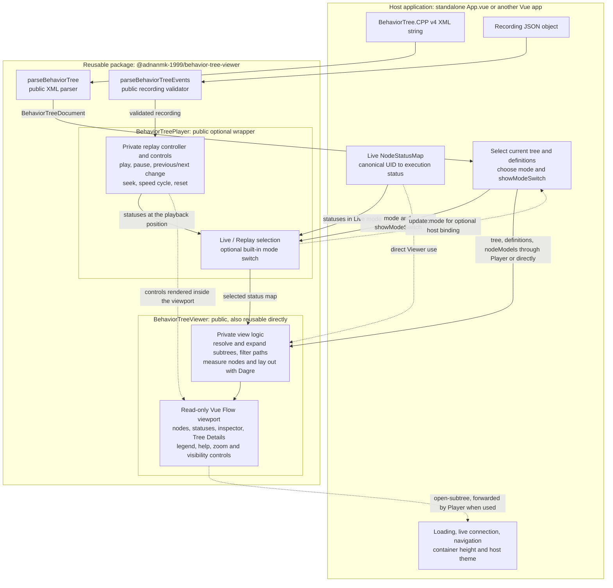

[**Explore the live demo →**](https://adnanmk-1999.github.io/behavior-tree-visualizer/)

# Behavior Tree Viewer

**See the structure. Follow the execution.**

An interactive Vue 3 viewer for BehaviorTree.CPP trees. Explore nested branches,
inspect node details, and follow execution statuses inside your own application.

```sh
npm ci
npm run dev
```

Open the URL printed by Vite. The playground loads `public/tree.xml` and
`public/data/behavior-tree-events.json`. If the recording is missing or invalid,
the tree remains available for navigation and inspection.

## Development and releases

| Branch    | Purpose                                                       |
| --------- | ------------------------------------------------------------- |
| `develop` | Ongoing development, documentation, and verification          |
| `main`    | Release-ready code used to build and publish package versions |

Work on `develop`, including release metadata and version updates. When the
changes are ready, merge them into `main` through a pull request. Build and publish
from a clean `main` checkout, tagging the released commit with `vX.Y.Z`.

Applications install a package version; they do not depend on a Git branch.
Merging into `main` does not automatically publish a package. Agent instructions
for this workflow are in [AGENTS.md](AGENTS.md).

## Library package

The package is `@adnanmk-1999/behavior-tree-viewer`, currently version `0.2.0`.
Its publish destination is GitHub Packages at `https://npm.pkg.github.com`.
An npmjs.com account is not needed for this registry.

`src/App.vue` owns the playground's loading and navigation. It uses local
`BehaviorTreePlayer` source during development. The player wraps
`BehaviorTreeViewer` with replay timing, transport controls, and an optional
Live/Replay switch. The playground enables this package-owned switch; it supplies
no viewport markup or control styles.
`src/index.ts` defines the library's public exports: both components,
`parseBehaviorTree`, `parseBehaviorTreeEvents`, and the tree/status/recording
TypeScript types. The package also exports `style.css`.

```sh
npm run build:lib    # library JavaScript, CSS, and declarations in dist-library/
npm run test:package # pack, install in a temporary consumer, check types, and build
npm pack             # rebuild and create adnanmk-1999-behavior-tree-viewer-0.2.0.tgz
```

Vue 3.5+ is supplied by the consuming application. Vue Flow and Dagre remain
implementation dependencies. The archive includes the compiled library, its public
declarations, icon license, README, and package metadata. Demo XML, recordings,
application code, and development tools stay in this repository.

The existing `npm run build` builds the standalone app into `dist/`. Packing and
testing work locally before a version is published.

### Architecture and reusable parts

The host supplies tree data and execution data. The package owns rendering and,
when using `BehaviorTreePlayer`, playback and its controls. Solid arrows show
data flow; dotted arrows show events, optional direct use, or UI composition.



Both components consume the same tree representation. The Player wraps the
Viewer and selects its status source; it does not duplicate the rendering code.
The package also exports its tree/status/recording TypeScript types and
`style.css`. Consumers import the stylesheet once and supply Vue as a peer
dependency. Vue Flow and Dagre are implementation dependencies.

| Component input | Used by | Required/default | Purpose |
| --- | --- | --- | --- |
| `tree` | Viewer and Player | Required | Current `BehaviorTreeDefinition` to display. |
| `definitions` | Viewer and Player | Required | All definitions, used to resolve subtree instances. |
| `nodeModels` | Viewer and Player | Optional | Registered node categories such as Action or Control. |
| `statuses` | Viewer and Player | Empty map | Current `NodeStatusMap`; the Player uses it in Live mode. |
| `recording` | Player | `null` | Validated `BehaviorTreeRecording`, used in Replay mode. |
| `mode` / `v-model:mode` | Player | Required | Explicitly select `'live'` or `'replay'`; binding allows the host to observe/control selection. |
| `showModeSwitch` | Player | `false` | Enable the package-owned Live/Replay buttons. |

`statuses` maps decimal-string UIDs to `IDLE`, `RUNNING`, `SUCCESS`, `FAILURE`, or
`SKIPPED`, for example `new Map([['44', 'RUNNING']])`. Missing entries display as
Not observed. A recording contains ordered, timestamped UID status transitions
and metadata; it is not a status snapshot or a raw MCAP file. Already prepared
tree objects and validated recordings can be supplied directly, without calling
the parser helpers again.

- Reuse **Viewer** when the host already controls status updates or playback timing.
- Reuse **Player** for a fixed Live mode, a fixed Replay mode, or both with the
  optional switch and built-in playback controls.
- Reuse either **parser independently** when another feature needs parsed tree
  definitions or validated recording data.
- Keep file/network loading, robot connections, breadcrumbs, selection of the
  current tree, and the parent container's size in the **host application**.

`open-subtree` supplies a reference node so the host can choose the next tree;
the Player forwards this event from its Viewer. Inline subtree expansion stays
inside the package. Live mode pauses replay, and returning to Replay preserves
its position. Changing the current tree also preserves playback; replacing the
recording resets it.

The public export boundary is [src/index.ts](src/index.ts). Playback/view
composables, layout utilities, icons, and child components are private
implementation details, even though they are shared within this repository.
The demo imports local Player source; its page shell, fixtures, and
`scripts/export_bt_events.py` remain outside the package. App builds go to
`dist/`; library JavaScript, CSS, and declarations go to `dist-library/`.

## Publish to GitHub Packages

Publishing is manual. GitHub initially creates the package with private
visibility; visibility is managed in its package settings. The manifest's
`publishConfig.registry` selects GitHub Packages, and `repository` links the
package to this source repository. The npm `private: true` flag is absent because
it would block publishing entirely. See [GitHub's npm registry guide](https://docs.github.com/en/packages/working-with-a-github-packages-registry/working-with-the-npm-registry).

### Authenticate

Create a **personal access token (classic)** in [GitHub token settings](https://github.com/settings/tokens)
with `write:packages` and `read:packages` for publishing. Consumers only need
`read:packages` and access to the package. See [GitHub package permissions](https://docs.github.com/en/packages/learn-github-packages/about-permissions-for-github-packages).
[Installation](#installation) · [Quick start](#quick-start) · [API](#api) · [Dependencies](#dependencies) · [Contributing](#contributing)

[](https://adnanmk-1999.github.io/behavior-tree-visualizer/)

_The demo combines the viewer with subtree navigation and recorded playback.
The package gives your application the viewer; you supply its data and timing._

## What you can do

- **Explore the hierarchy.** Automatic layout, expandable branches, and subtree boundaries make nested trees easier to follow.
- **Follow execution.** Display node statuses, highlight running paths, and focus on active branches.
- **Inspect the details.** Select a node to see its attributes, category, and execution status.
- **Navigate comfortably.** Pan, zoom, frame the diagram, and move between nodes with the keyboard.
- **Fit your application.** Use CSS theme variables and a typed Vue API with static, recorded, or live data.

The viewer is read-only. Your application owns loading, connections, navigation,
and playback timing; the component handles rendering and interaction.

## Installation

The package is available from **GitHub Packages** as
`@adnanmk-1999/behavior-tree-viewer`. Use Vue 3 (`^3.5.0`) and a modern browser.
For installation and local development, Node.js 24.12+ is supported; see
[package.json](https://github.com/adnanmk-1999/behavior-tree-visualizer/blob/main/package.json)
for the full Node.js version range.

For the first release, publish:

```sh
npm publish
```

After publishing succeeds, tag the source commit:

```sh
git tag -a v0.2.0 -m "Release 0.2.0"
git push origin v0.2.0
```

For later releases, use the version from `package.json` in both the tag and the
installation command.
Verify the published version by installing it in another application as below.

A later move to npmjs.com requires an npm account with access to the chosen scope,
an update to `publishConfig.registry`, and publication to that registry. Consumers
must update their registry mapping and reinstall the package to refresh lockfile
URLs. Moving to a company scope also changes the package name and import paths;
existing installations keep using the old package until updated.

## Use the viewer in another Vue application

After publication, authenticate as above and add this scope mapping to the
consuming application's `.npmrc` (beside its `package.json`):
Add this scope mapping to your application's `.npmrc`, beside `package.json`:

```ini
@adnanmk-1999:registry=https://npm.pkg.github.com
```

Authenticate with your GitHub username and a **personal access token (classic)**
with `read:packages` and access to this package. Use the token at the password
prompt; keep it in your user-level npm credentials, outside the repository.
An npmjs.com account is not required. See [GitHub's authentication guide](https://docs.github.com/en/packages/working-with-a-github-packages-registry/working-with-the-npm-registry#authenticating-to-github-packages).

```sh
npm install @adnanmk-1999/behavior-tree-viewer@0.2.0
npm login --scope=@adnanmk-1999 --auth-type=legacy --registry=https://npm.pkg.github.com
npm install @adnanmk-1999/behavior-tree-viewer@0.1.0
```

To download the package as a `.tgz` archive after authenticating, run
`npm pack @adnanmk-1999/behavior-tree-viewer@0.1.0`.

```sh
npm install /absolute/path/to/adnanmk-1999-behavior-tree-viewer-0.2.0.tgz
```
## Quick start

Import the component and stylesheet, parse your XML, and give the viewer a
container with a definite height. The component and parser run in the browser;
mount them on the client when using an SSR framework.

```vue
<script setup lang="ts">
import { shallowRef } from 'vue'
import {
  BehaviorTreeViewer,
  parseBehaviorTree,
  type NodeStatusMap,
} from '@adnanmk-1999/behavior-tree-viewer'
import '@adnanmk-1999/behavior-tree-viewer/style.css'

const document = parseBehaviorTree(`
  <root BTCPP_format="4">
    <BehaviorTree ID="Delivery">
      <Sequence _uid="1">
        <Condition ID="IsReady" _uid="2"/>
        <Action ID="MoveToGoal" _uid="3"/>
      </Sequence>
    </BehaviorTree>
  </root>
`)
const tree = document.behaviorTrees[0]!
const statuses = shallowRef<NodeStatusMap>(
  new Map([
    ['1', 'RUNNING'],
    ['2', 'SUCCESS'],
    ['3', 'RUNNING'],
  ]),
)
</script>

<template>
  <div style="height: 600px">
    <BehaviorTreeViewer
      class="my-tree"
      :tree="tree"
      :definitions="document.behaviorTrees"
      :node-models="document.nodeModels"
      :statuses="statuses"
    />
  </div>
</template>
```

`tree` and `definitions` are required; `nodeModels` and `statuses` are optional.
The `open-subtree` event supplies the reference node without its children, so the
host can implement navigation. The viewer handles rendering, layout, pan/zoom,
inspection, legends, and branch expansion.
The player's optional Live/Replay switch sits in its own toolbar above the
diagram, outside the viewer canvas. Replay controls sit inside the viewport in a
wide, low bar beside Tree Details, stacking below it on narrow canvases.
For structured tree data, pass a `BehaviorTreeDefinition` directly; XML parsing
is optional.

### Update execution statuses

`NodeStatusMap` is a `ReadonlyMap<string, ExecutionStatus>`, keyed by node UID.
Use canonical unsigned decimal strings such as `"3"`, rather than node names or
padded strings such as `"0003"`.

Supported statuses are `IDLE`, `RUNNING`, `SUCCESS`, `FAILURE`, and `SKIPPED`.
Nodes absent from the map appear as **Not observed**. Replace a shallow-ref map
when a new snapshot arrives:

```ts
statuses.value = new Map([
  ['1', 'SUCCESS'],
  ['2', 'SUCCESS'],
  ['3', 'SUCCESS'],
])
```

The application owns its data connections and navigation. Use
`BehaviorTreeViewer` when the host supplies all status updates, or
`BehaviorTreePlayer` to include recording playback. The package resolves this
repository's source aliases, so consumers need no `@` configuration.

### Choose Live or Replay in the host application

Using the same tree data as above, load recording JSON in the host and validate
it with `parseBehaviorTreeEvents` before passing it to the player:

```vue
<script setup lang="ts">
import { shallowRef } from 'vue'
import {
  BehaviorTreePlayer,
  parseBehaviorTreeEvents,
  type BehaviorTreeRecording,
} from '@adnanmk-1999/behavior-tree-viewer'
import '@adnanmk-1999/behavior-tree-viewer/style.css'

const recording = shallowRef<BehaviorTreeRecording | null>(null)
// After fetching JSON, assign recording.value = parseBehaviorTreeEvents(json).
// The host handles loading errors and supplies matching tree definitions.
</script>

<template>
  <div style="height: 700px">
    <BehaviorTreePlayer
      mode="replay"
      :tree="tree"
      :definitions="treeDocument.behaviorTrees"
      :node-models="treeDocument.nodeModels"
      :recording="recording"
    />
  </div>
</template>
```

The player requires `tree`, `definitions`, and `mode` (`'live'` or `'replay'`);
there is no default mode. It also accepts optional `nodeModels`, `statuses`,
`recording`, and `showModeSwitch` (default `false`). A live application sets
`mode="live"` and supplies `:statuses="liveStatuses"`; a replay application sets
`mode="replay"` and supplies a recording. Fixed-mode applications leave
`showModeSwitch` off.
The host owns the live connection; the player opens no connections. Replay
uses its own status map, leaving the host's map untouched. A host that supports
both sources can enable `show-mode-switch` to include the package's Live/Replay
tabs, as the playground does. The package owns the tabs' markup, styles,
keyboard interaction, and selection; no host slot content is needed. Bind
an initialized `v-model:mode` to observe or control selection, or pass an explicit
`mode` without a model binding to let the player manage subsequent tab changes
internally. Switching to Live
pauses replay; returning to Replay retains the position and stays paused.
Changing the displayed tree preserves playback; replacing the recording resets it.
The player forwards the viewer's `open-subtree` event for host navigation.

Replay includes Play/Pause, Reset, seeking, speed, **Previous change**, and
**Next change**. Stepping pauses at the previous or next distinct timestamp in
the complete recording, including events for hidden nodes or other subtrees.
All transitions at that timestamp are applied together. Both skip buttons retain
their normal appearance at recording boundaries; stepping beyond either end
leaves the position unchanged. Click either skip button for one change, or hold
it to keep stepping until release. Holding doubles the repeat rate each second
after the initial delay, up to 40 changes per second; a new hold starts slowly
again. Missing or empty recordings disable transport
while leaving the diagram available. No playback controls
are added to the standalone `BehaviorTreeViewer`.
The horizontal replay bar places icon-only Previous change, Play/Pause, and Next
change buttons together, with Reset at the far right after speed. All buttons
have tooltips. It also provides time and seeking. It appears only in Replay
mode and stays fixed while the graph pans and zooms; the surrounding app supplies
no control markup.
Click the speed button to cycle through 0.5×, 1×, 2×, and 4×, wrapping back to
0.5× after 4×. The button displays the current speed and starts at 1×.
The same interface works with a static snapshot, a playback controller, or live
updates from your application's API or WebSocket connection.

## API

### `BehaviorTreeViewer`

| Prop          | Type                                | Purpose                                                       |
| ------------- | ----------------------------------- | ------------------------------------------------------------- |
| `tree`        | `BehaviorTreeDefinition`            | **Required.** The tree to display.                            |
| `definitions` | `readonly BehaviorTreeDefinition[]` | **Required.** Definitions used to resolve subtree references. |
| `nodeModels`  | `NodeCategoryMap`                   | Optional mapping of node type IDs to categories.              |
| `statuses`    | `NodeStatusMap`                     | Optional UID-to-status map. Defaults to an empty map.         |

The **`open-subtree`** event emits the reference node without its children
(`Omit<BehaviorTreeNode, 'children'>`). Handle it to navigate to another tree
inside your application. Expanding a subtree within the current view is built in.

In Replay mode the player adds Play/Pause, Reset, Previous/Next change, seeking, and
0.5×/1×/2×/4× speeds. The package also provides an optional Live/Replay switch.
The playground enables it, adds breadcrumbs, and starts in Replay; it has no live
robot connection. Navigation preserves the current playback position.
### `parseBehaviorTree(xml)`

Returns a `BehaviorTreeDocument` containing `behaviorTrees`, `nodeModels`, and
root `attributes`. It expects `<root BTCPP_format="4">` and throws for malformed
XML or an invalid document structure. Definitions retain their document order;
UIDs and attributes remain strings, and subtrees remain references.

The parser preserves expressions as data and never executes them. It does not
load external includes or validate custom node schemas.

### TypeScript exports

- **Trees:** `BehaviorTreeDocument`, `BehaviorTreeDefinition`, `BehaviorTreeNode`, `SubTreeReference`.
- **Categories:** `NodeCategory`, `NodeCategoryMap`.
- **Statuses:** `NodeStatusMap`, `ExecutionStatus`, `DisplayStatus`.

## Make it yours

The viewer fills its container and inherits your application's font. Load the
font before mounting so the layout can measure labels correctly. Customize the
component in the quick-start example with CSS variables:

```css
.my-tree {
  --bt-background: #151b26;
  --bt-surface: #202a38;
  --bt-primary: #6ee7b7;
}
```

The default theme works without Vuetify. Inherited Vuetify `--v-theme-*` RGB
variables are also supported. See the [theme variables](https://github.com/adnanmk-1999/behavior-tree-visualizer/blob/main/src/assets/workspace.css)
and [category/status styles](https://github.com/adnanmk-1999/behavior-tree-visualizer/blob/main/src/assets/behaviorTreeAppearance.css)
for additional overrides. Give separate Vue apps on the same page distinct
`app.config.idPrefix` values for accessibility IDs.

<details>
<summary><strong>Keyboard and canvas controls</strong></summary>

| Action                      | Control                                              |
| --------------------------- | ---------------------------------------------------- |
| Inspect a node              | Click or Enter; Escape closes the inspector          |
| Expand or collapse a branch | Double-click, Space, or the node's plus/minus button |
| Navigate between nodes      | Arrow keys                                           |
| Pan                         | Drag the canvas or use W, A, S, D                    |
| Zoom                        | Scroll, plus/minus keys, or the zoom buttons         |
| Frame the diagram           | Fit tree or Readable view                            |
| Open a subtree separately   | Open subtree separately in the inspector             |

Keyboard shortcuts apply while the canvas or a node has focus. The toolbar also
provides a running-path filter, collapsed/all/running subtree modes, and
independent Subtree and Control highlighting.

</details>

## Dependencies

The build includes TypeScript checking. Run `npm run test:package` for changes to
the public API, package configuration, or library build. With the dev server
running, `/tests/parseBehaviorTree.html` checks the browser XML parser and graph
against the supplied fixture.
`/tests/behaviorTreePlayer.html` checks fixed live/replay modes, the package-owned
switch, keyboard access, stepping, navigation, and missing/empty recordings. `/tests/behaviorTreeSizing.html`
checks initial label widths and click stability with inherited fonts.
Built on these projects:

| Project                                   | Package                                  | Role                                                                                 |
| ----------------------------------------- | ---------------------------------------- | ------------------------------------------------------------------------------------ |
| [Vue 3](https://vuejs.org/)               | `vue` — peer dependency, `^3.5.0`        | Component rendering and reactive updates, using your application's Vue installation. |
| [Vue Flow](https://vueflow.dev/)          | `@vue-flow/core` — dependency, `^1.48.2` | Interactive graph canvas, nodes, edges, pan, and zoom.                               |
| [Dagre](https://github.com/dagrejs/dagre) | `@dagrejs/dagre` — dependency, `^3.1.1`  | Automatic top-to-bottom layout of the tree.                                          |

Vue Flow and Dagre are installed with the package. TypeScript declarations and
the viewer stylesheet are included. Development uses Vite, TypeScript, and
`vue-tsc`.

The subtree icon uses Pictogrammers' Material Design Icons; its
[Apache 2.0 license and attribution](https://github.com/adnanmk-1999/behavior-tree-visualizer/blob/main/public/licenses/material-design-icons.txt)
are included in the package.

## Run the demo locally

```sh
git clone https://github.com/adnanmk-1999/behavior-tree-visualizer.git
cd behavior-tree-visualizer
npm ci
npm run dev
```

Open the URL printed by Vite. The playground uses the local viewer source and
loads `public/tree.xml` with `public/data/behavior-tree-events.json`. It adds
breadcrumbs, playback controls, seeking, and playback speeds. If the recording
is unavailable, the tree can still be explored.

## Contributing

Bug reports, documentation improvements, and focused pull requests are welcome.

1. Fork the repository if needed, and create a branch from **`develop`**.
2. Make your change and run the relevant checks described in [AGENTS.md](https://github.com/adnanmk-1999/behavior-tree-visualizer/blob/main/AGENTS.md).
3. Open a pull request targeting **`develop`**, with a short description of the change and how you verified it. Include a screenshot for visual changes.

Use [GitHub Issues](https://github.com/adnanmk-1999/behavior-tree-visualizer/issues)
to report a problem with reproduction steps and a small example tree when possible.
